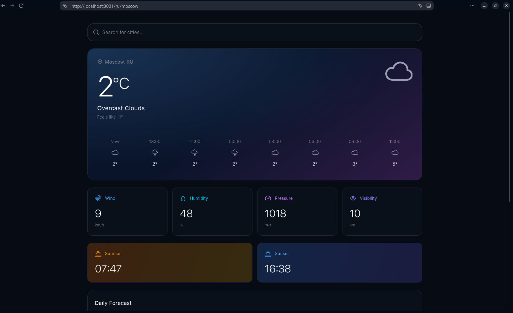
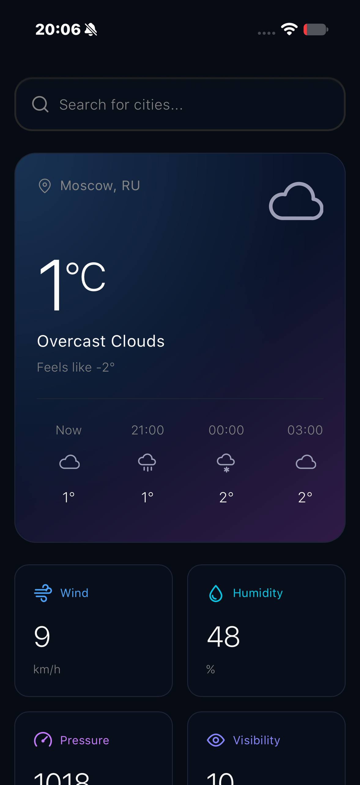

# Weather App

[Read in Russian](README.ru.md) | English

Weather app with city search, geolocation, current conditions, and a five-day forecast.

Built with Next.js, TypeScript, CSS Modules, and Motion.

## Screenshots





## Features

- **Search:** City and country search with keyboard navigation.
- **Location:** Geolocation and remembered last-selected city.
- **Current weather:** Temperature, feels-like, wind, humidity, pressure, visibility, sunrise, and sunset.
- **Forecast:** Three-hour intervals grouped into daily temperature ranges, with times shown for the selected city.
- **UI:** Responsive layout, blurred loading placeholders, and retry actions for temporary failures.

## Quick Start

Requires Node.js 24 and npm.

```bash
npm ci
cp .env.template .env
# Set WEATHER_API_KEY in .env
npm run dev
```

Open http://localhost:3000.

## Environment

| Variable          | Required | Description                                                  |
| :---------------- | :------- | :----------------------------------------------------------- |
| `WEATHER_API_KEY` | Yes      | API key from [OpenWeather](https://openweathermap.org/).     |
| `ALLOWED_ORIGINS` | No       | Extra development hosts allowed by Next.js, comma-separated. |

## Commands

```bash
npm run build        # Production build
npm start            # Serve the production build
npm run lint         # ESLint
npm run typecheck    # TypeScript
npm run format:check # Prettier
npm test             # Vitest
```

Browser tests:

```bash
npx playwright install --with-deps chromium
npm run build:e2e
npm run test:e2e
```

_Made with ❤️ by Quarnel_
