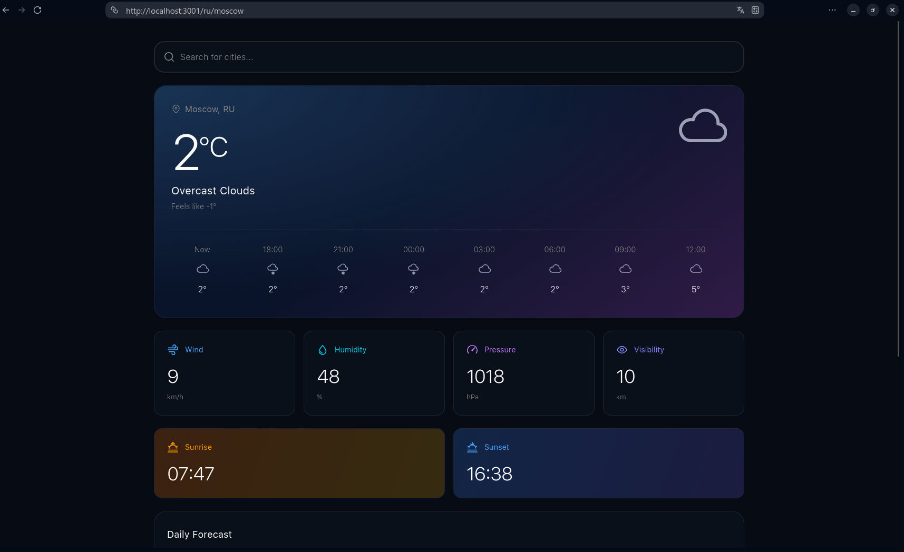
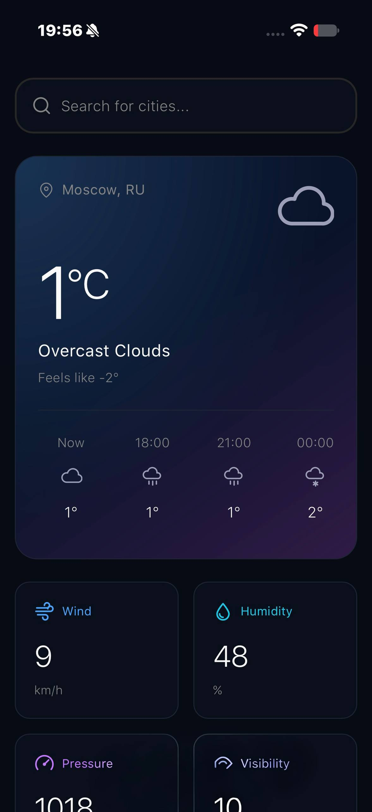

# Weather App

[Читать на английском](README.md) | Русский

Погодное приложение с поиском городов, геолокацией, текущей погодой и прогнозом на пять дней.

Написано на Next.js, TypeScript, CSS Modules и Motion.

## Скриншоты





## Возможности

- **Поиск:** Поиск по городам и странам с навигацией с клавиатуры.
- **Местоположение:** Геолокация и запоминание последнего выбранного города.
- **Текущая погода:** Температура, ощущаемая температура, ветер, влажность, давление, видимость, восход и закат.
- **Прогноз:** Данные с интервалом три часа, сгруппированные по дням с диапазонами температур. Время отображается для выбранного города.
- **Интерфейс:** Адаптивная вёрстка, размытые заглушки загрузки и повтор запросов при временных ошибках.

## Быстрый старт

Требуются Node.js 24 и npm.

```bash
npm ci
cp .env.template .env
# Укажите WEATHER_API_KEY в .env
npm run dev
```

Откройте http://localhost:3000.

## Переменные окружения

| Переменная | Обязательная | Описание |
| :--------- | :----------- | :------- |
| `WEATHER_API_KEY` | Да | Ключ API из [OpenWeather](https://openweathermap.org/). |
| `ALLOWED_ORIGINS` | Нет | Дополнительные хосты для Next.js в режиме разработки, через запятую. |

## Команды

```bash
npm run build        # Продакшн-сборка
npm start            # Запуск продакшн-сборки
npm run lint         # ESLint
npm run typecheck    # TypeScript
npm run format:check # Prettier
npm test             # Vitest
```

Браузерные тесты:

```bash
npx playwright install --with-deps chromium
npm run build:e2e
npm run test:e2e
```

*Сделано с ❤️ от Quarnel*